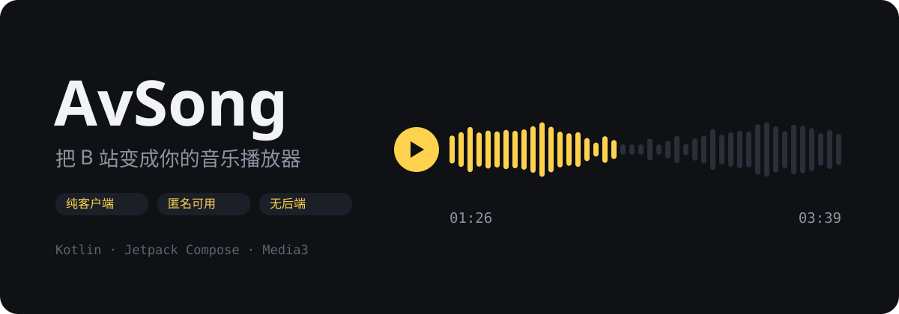
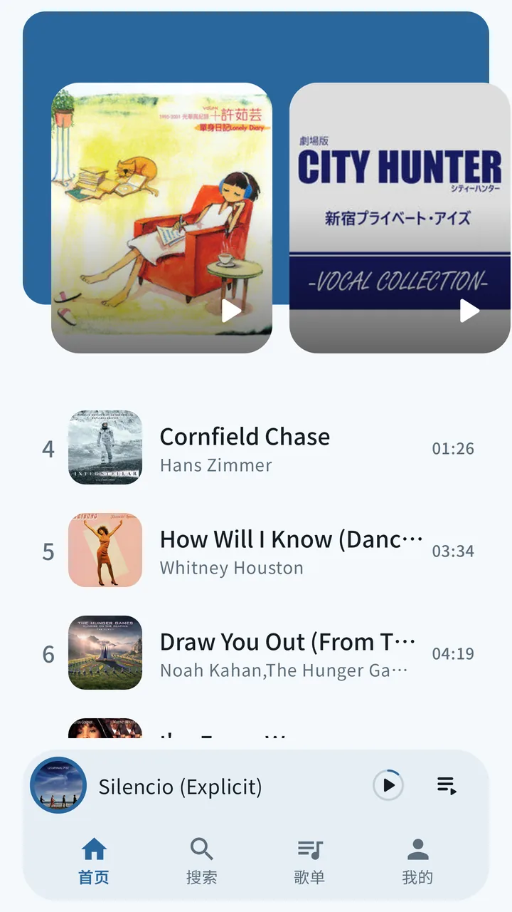
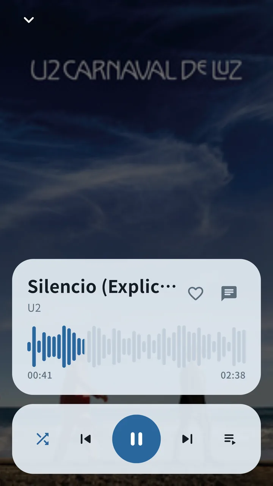
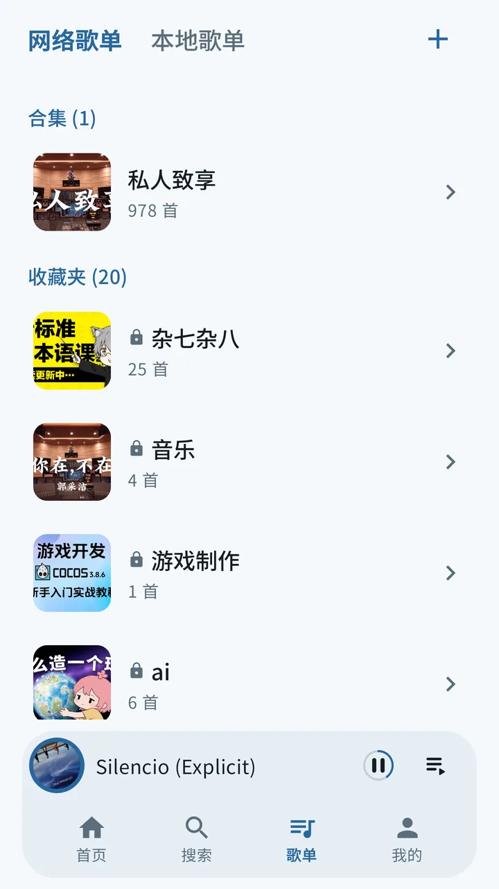
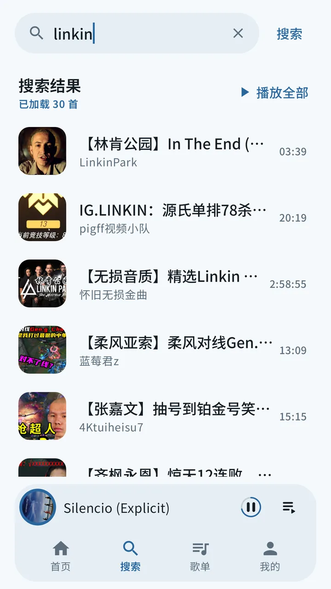

<div align="center">



<p>
  
  
  
  
</p>

</div>

## 这是什么

**弦 Xian 是一个基于 B 站公开 API 的安卓音乐播放器**：搜索、热歌榜、收藏夹、UP 主合集、离线下载、逐字歌词、热评弹幕——把一个视频网站当成音乐 App 来用。

纯客户端、匿名可用、无后端。不缓存任何音频直链（B 站直链约 3 小时过期，播放时实时解析），不需要注册账号也能听。

<div align="center">
<table>
<tr>
<td align="center"></td>
<td align="center"></td>
<td align="center"></td>
<td align="center"></td>
</tr>
<tr>
<td align="center"><sub>首页 · 精选轮播 + 热歌榜</sub></td>
<td align="center"><sub>播放页 · 波形进度条</sub></td>
<td align="center"><sub>歌单中心 · 网络 / 本地</sub></td>
<td align="center"><sub>搜索 · 联想 + 直达 BV 号</sub></td>
</tr>
</table>
</div>

## 功能

| | |
|---|---|
| **播放** | 迷你条 + 全屏播放页、波形进度条、交叉淡入淡出、倍速、睡眠定时、后台通知 / 媒体键 |
| **歌单** | B 站收藏夹读写、UP 主合集订阅（支持 978 首大合集边播边补全）、**本地自建歌单**（纯本地、不依赖登录） |
| **多选批量** | 歌单内原地多选：批量下载 / 收藏 / 下一首 / 入队 / 移除 |
| **下载离线** | 队列化下载、断网播放、孤儿文件自愈扫描 |
| **歌词** | 多源自动匹配（B 站 AI 字幕 → bgm.tv → 网易云）+ 时长校验、逐行高亮 |
| **热评** | 播放页热评弹幕 / 列表双模式，点赞（含乐观更新） |
| **登录** | 扫码登录 + Cookie 自动续期（correspond 接口） |
| **其它** | 搜索联想 / 直达 BV 号、播放历史、深浅双主题 + 色相轮盘、桌面小部件 |

## 怎么用

**从源码构建**（需要 JDK 21 + Android SDK）：

```bash
./gradlew.bat assembleDebug          # 产物 → app/build/outputs/apk/debug/app-debug.apk
./gradlew.bat installDebug           # 直接安装到已连接的设备
```

**使用要点**

- 匿名即可搜索、听歌、建本地歌单；**收藏夹 / 合集同步需要扫码登录**；
- 播放页爱心长按 = 管理收藏夹，点按 = 收藏 / 一键取消；
- 搜索框可直接粘贴 `BV` 号或 `b23.tv` 短链，自动解析直达；
- 歌单详情右上「+」可粘贴 UP 主合集链接（`space.bilibili.com/<mid>/lists/<sid>`）订阅为歌单。

## 架构速览

```
UI (Compose) ── MainViewModel ── PlayerController ── MusicService (Media3)
                                      │
                          bili://<bvid> 自定义 URI
                                      │
                     ResolvingDataSource ── playurl 实时解析直链
                                            (FLAC > 杜比 > 192K,错误自动换 CDN)
```

- **无 DI 框架**：`Application` 持单例，ViewModel 经工厂注入；
- **直链永不缓存**：播放 URI 恒为 `bili://<bvid>`，ExoPlayer 加载时经 ResolvingDataSource 现取直链（3 小时过期问题天然自愈）；
- **本地优先**：已下载曲目自动走 `file://`，断网可用；本地歌单纯 DataStore，不依赖网络；
- **技术栈**：Kotlin 2.2 · Jetpack Compose (Material 3) · Media3/ExoPlayer · OkHttp · kotlinx.serialization。

更多设计细节见 [`docs/ARCHITECTURE.md`](docs/ARCHITECTURE.md)；B 站接口配方与实测坑见 [`docs/bilibili-api.md`](docs/bilibili-api.md)。

## 说明

- 「弦」= 一根弦是一个音——把散落在 B 站视频里的好听声音捡起来，「发现好歌、听到好歌」都在一处；
- 本项目仅用于个人学习与自用，**不提供任何内容托管**，所有数据来自 B 站公开 API；
- 请遵守 B 站用户协议，不要用于商业用途或大规模抓取；
- 未做：本地音频文件扫描、下载目录自定义、播放上报。

<div align="center">
<sub>用 Kotlin 和 Compose 手写 · 无广告 · 无追踪 · 无后端</sub>
</div>
